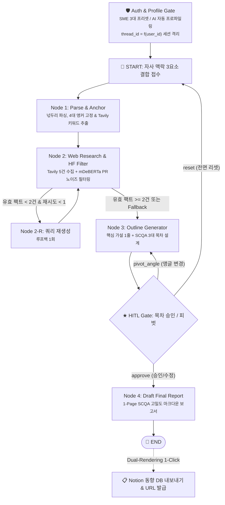

# 🧭 So-What Agent (소왓 에이전트)

> 전략기획실이 없는 **중소기업(SME) 및 스타트업 대표/실무자**를 위한 실무 전략 부사수 AI  
> 단순 팩트 나열을 넘어 **"그래서 우리 회사는 뭘 해야 하는가?(So What)"**를 2분 이내에 도출하는 엔터프라이즈 전략 브리프 생성 시스템

<p align="left">
  
  
  
  
  
  
</p>

---

## 📌 1. 프로젝트 개요 (Overview)

* **타깃 고객 (Target Audience)**: 전략기획실 및 전담 분석팀 부재로 대표 및 실무자가 1인 다역을 수행하는 중소기업(SME) 및 스타트업
* **핵심 가치 (Value Proposition)**:
  1. **자사 비즈니스 맥락 자동 주입**: 쇼핑몰, SaaS, 물류 등 우리 회사의 사업 영역, 인프라 제약, 목표 KPI를 지시문에 자동 결합하여 "우리 회사 관점의 시사점" 도출
  2. **HF Zero-Shot PR 노이즈 필터링**: 수십 건의 기사 중 홍보성 보도자료를 로컬 언어모델(`mDeBERTa-v3`)로 사전 배제하여 순수 비즈니스 팩트만 선별
  3. **HITL 3-Way 의사결정 게이트**: 가설 및 SCQA 3대 목차를 실무자가 즉시 검토·인라인 수정하거나, 재검색 없이 30초 내 관점(앵글) 피벗
  4. **Notion 1-Click 발행 & Dual-Rendering**: 화면에서는 카드·콜아웃 대시보드로 보고서를 열람하고, Notion DB에는 깨짐 없는 순수 마크다운으로 1-Click 적재

---

## 🏗️ 2. 시스템 아키텍처 & 워크플로우



---

## 🛠️ 3. 기술 스택 (Tech Stack)

| 구분 | 도입 기술 | 실무 적용 목적 및 규격 |
| :--- | :--- | :--- |
| **Orchestration** | LangGraph, langchain-core | • 상태 머신 기반 노드 제어, 3-Way 조건부 분기, HITL 인터럽트 |
| **Checkpointer** | MemorySaver | • 세션 격리(`thread_{user_id}_{hash}`), Time-Travel 무손실 롤백 |
| **Frontend** | Streamlit | • 4단계 Stepper, Dynamic Key 바인딩 캐시 방지, 계층화된 3-Way 액션 바 |
| **Search Engine** | Tavily Search API | • 광고/스크립트 배제 순수 비즈니스 동향 기사 고속 수집 |
| **PR Noise Filter** | Hugging Face mDeBERTa-v3 | • 로컬 Zero-Shot 분류 (100자 슬라이싱, PR 점수 ≥ 0.5 배제) |
| **LLM Engine** | OpenAI (gpt-4o-mini) | • Pydantic 구조화 앵커 파싱, SCQA 1-Page 마크다운 전략 보고서 작성 |
| **Collab Export** | Notion REST API | • 사내 노션 데이터베이스 1-Click 전송 및 열람 URL 발급 |

---

## 📂 4. 프로젝트 디렉토리 구조

```plaintext
myteam2/
├── .env.example          # 환경변수 템플릿
├── requirements.txt      # 프로젝트 의존성 라이브러리 목록
├── README.md             # 프로젝트 기술 명세 및 실행 가이드
│
├── core/                 # [Core Freeze] LangGraph 파이프라인 코어 엔진
│   ├── __init__.py
│   ├── state.py          # AgentState 및 Pydantic 스키마
│   ├── tools.py          # Tavily 검색 / HF 필터링 / Notion 익스포트
│   ├── nodes.py          # 4대 핵심 노드 로직
│   └── graph.py          # StateGraph 조립 및 컴파일
│
├── auth.py               # SME 3대 프리셋, AI 프로파일링, 세션 격리 ID
├── app.py                # 엔터프라이즈 Streamlit 메인 대시보드
│
└── tests/                # 단위 / 통합 / 벤치마크 테스트 스위트
    ├── test_auth_unit.py              # 인증 & 안전 폴백 단위 테스트 (Phase 6)
    ├── test_sprint6_2_integration.py  # 자사 맥락 주입 통합 테스트 (Phase 6)
    ├── test_domain_benchmarks.py      # 3대 SME 도메인 E2E 벤치마크 (Phase 6)
    ├── test_pipeline_cli.py           # CLI E2E 파이프라인 테스트 (Phase 5)
    ├── test_tavily.py                 # Tavily 수집 단위 테스트 (Phase 3)
    ├── test_hf_filter.py              # HF PR 필터링 단위 테스트 (Phase 3)
    └── test_notion.py                 # Notion 연동 단위 테스트 (Phase 3)
```

---

## 🚀 5. 빠른 시작 (Quick Start: 3단계)

### 1단계: 가상환경 생성 및 패키지 설치

```bash
# 가상환경 생성 및 활성화
python -m venv .venv
source .venv/bin/activate  # Windows PowerShell: .\.venv\Scripts\Activate.ps1

# 의존성 패키지 설치
pip install -r requirements.txt
```

### 2단계: 환경변수 설정 (`.env`)

`.env.example`을 복사하여 `.env`를 생성하고 API 키를 입력합니다:

```ini
OPENAI_API_KEY=sk-proj-xxxxxxxxxxxxxxxxxxxxxxxxxxxxxxxx
TAVILY_API_KEY=tvly-xxxxxxxxxxxxxxxxxxxxxxxxxxxxxxxx
NOTION_TOKEN=ntn_xxxxxxxxxxxxxxxxxxxxxxxxxxxxxxxxxxxxxxxx
NOTION_DATABASE_ID=xxxxxxxxxxxxxxxxxxxxxxxxxxxxxxxx
```

### 3단계: Streamlit 대시보드 구동

```bash
streamlit run app.py
```
* **브라우저 접속 후 이용 순서**:
  1. 좌측 사이드바에서 **[🛒 쇼핑몰 URL]**(자사몰, 스마트스토어, 쿠팡) 입력 후 **[🚀 세션 생성 및 전략 분석 시작]** (브랜드명은 미입력 시 자동 추출)
  2. 메인 화면에서 4대 표준 보고서 추천 예시를 참고하여 상사 지시문 입력 ──▶ **[🚀 팩트 수집 및 목차 생성]** 클릭
  3. **[HITL 게이트]**에서 자동 진단된 정식 보고서 유형 배지, 가설 및 SCQA 목차 검토 (인라인 수정 또는 이커머스 관점 피벗)
  4. **[✅ 목차 승인]** 클릭 ──▶ **고밀도 1장 전략 브리프 (마크다운 비교 표 포함)** 열람 및 **[🚀 Notion 1-Click 발행]**

---

## 🧪 6. 테스트 및 벤치마크 검증

```bash
# 1. 쇼핑몰 URL 감지, 사번 검증 및 4대 표준 보고서 진단 (Sprint 6-1, 6-2)
python -m unittest tests/test_auth_unit.py

# 2. 고밀도 1장 전략 브리프 및 Dual-Rendering 원칙 검증 (Sprint 6-4)
python -m unittest tests/test_report_quality.py

# 3. 3대 B2C 이커머스 도메인(패션 D2C, 스마트스토어, 쿠팡) E2E 벤치마크 검증 (Sprint 6-5)
python -m unittest tests/test_domain_benchmarks.py
```